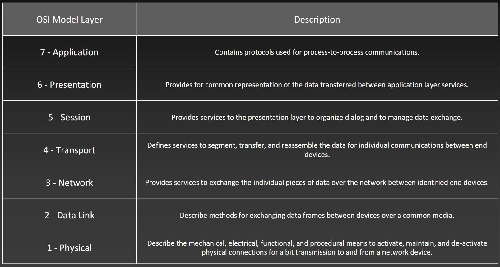
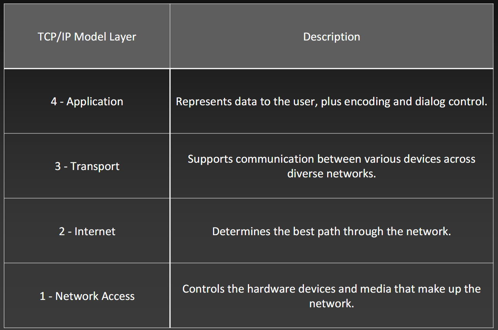
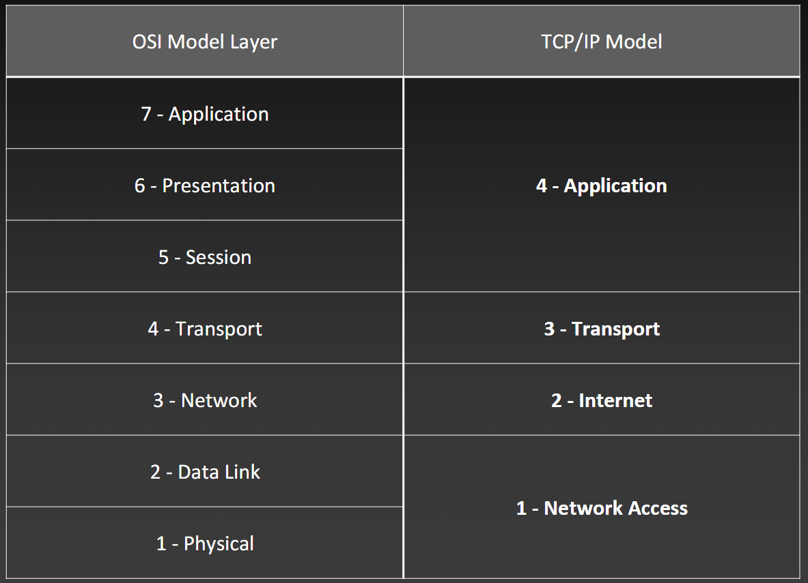

<h1>Configure Users using GitBash Commands</h1>

- git config --global user.name "Benjamin Pedrin"
- git config --global user.email "pedrinb@students.westerntc.edu"
- git config --global core.autocrlf true
- git config --global --list

<h2>Creating SSH keys</h2>

Commands
 
- ssh-keygen -t ed25519 -C "pedrinb@students.westerntc.edu"

<h3>1. Start the agent and add the key (Holds key in memory while computer is on)</h3>

  - eval "$(ssh-agent -s)"
  - ssh-add ~/.ssh/id_ed25519

<h3>2. Print & Copy Public Key</h3>

- cat ~/.ssh/id_ed25519.pub

<h3>3. Testing your connection</h3>

- ssh -T git@github.com

<h1>Basic Switch and End Device Configuration</h1>

Access Methods

<h3>Access Methods</h3>

<ul class="normal">
  <li>Console
    <ul>
      <li>Physical management port</li>
      <li>Out-of-Band - refers to access via a cable or dedicated management channel used for maintenance only!</li>
      <li>Cable required</li>
    </ul>
  </li>
  <li>Telnet
    <ul>
      <li>In-Band - Insecure</li>
      <li>Over Network - used once the IP has been configured</li>
      <li>Requires active networking services on the device</li>
      <li class="HOT">NOT ENCRYPTED</li>
    </ul>
  </li>
  <li>Secure Shell (SSH)
    <ul>
      <li>In-Band</li>
      <li class="HOT">SECURE</li>
    </ul>
  </li>
</ul>

<h2>1. User EXEC Mode Commands(View-Only)</h2>

<h2>2. Privileged EXEC Mode Commands</h2>

<strong>Show Image</strong>

<h2>3. Global Config Mode</h2>

- Identified with prompt that ends with  "(config)#"
  - a. **<u>Line Configuration Mode</u>** - used to config console, SSH, Telnet or AUX access
  - b. **<u>Interface Configuration Mode</u>** - used to config a switch, port or router network interface

 

<strong>Mode Changes</strong>

 

<h1>Commands</h1>

- line interface vlan 1
- no ip domain-lookup

<h1>Syntax</h1>

<strong>Syntax Help</strong>

For help in the CLI, enter a question mark (<em class="shortcut"> ? </em>)prompt.
- this is *context sensitive* meaning that the help you get will be determined by where and when you seek the help

<h1>Hotkeys & Shortcuts</h1>

<strong>Hotkeys Cheatsheet</strong>

 

<h1>Naming Devices</h1>

- When naming a device, enter Privileged EXEC Mode on the device and use <strong><u>hostname</u></strong> or <strong><u>no hostname</u></strong> to change the name or return it to it's original prompt name

 

<h1>Configuring Passwords</h1>

<strong>Password Commands</strong>

Setting User Password:

- line console 0
- password x4fr7
- login

Setting Enable Password

- enable password Ft6dR
- enable secret 7Fre4M

Setting VTY Password

- line vty

To clear a password, simply type "NO" before any command

<strong>Encryption Commands</strong>

<strong>Banner Message</strong>

 

Do Not Use "enable password" | Use "enable secret"

 

Configurations commands "shortlist"
- show running-config
- show startup-config
- reload
- erase startup-config
- copy running-config startup-config (copy run start)

# Configuring A Virtual Interface

<strong>Vlan Config</strong>

command: "show ip interface brief"
 

<h1>Reference Models</h1>

"All People Seem To Need Data Processing"

<strong>OSI Model</strong>

<strong>TCP/IP Model</strong>

<strong>Model Comparison</strong>

 