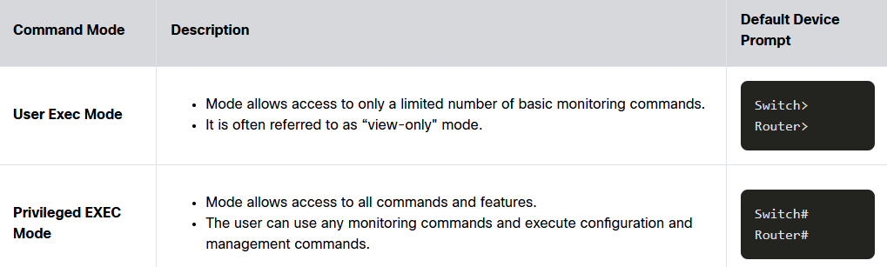
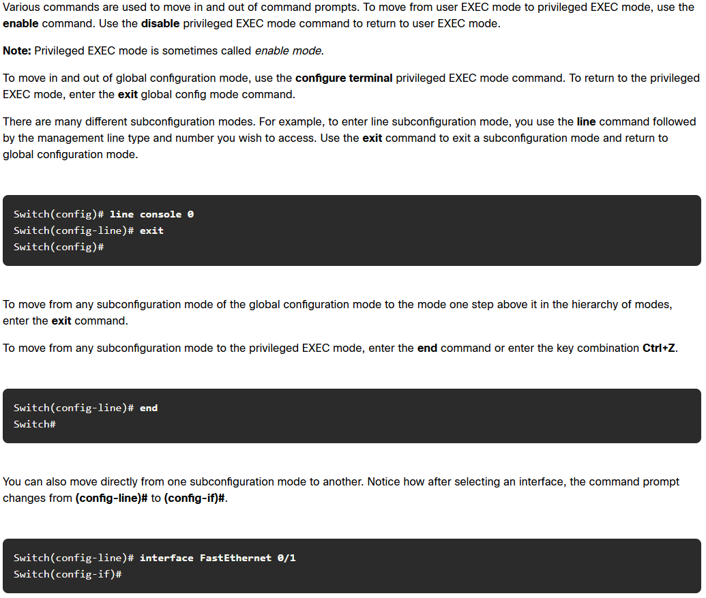
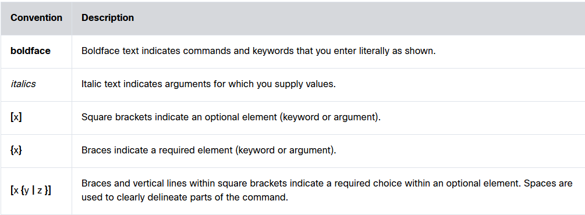
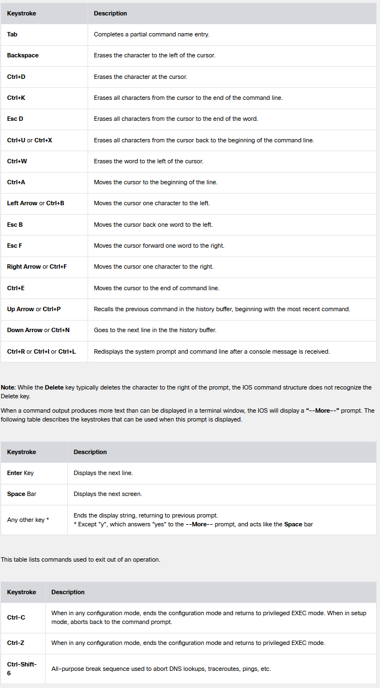
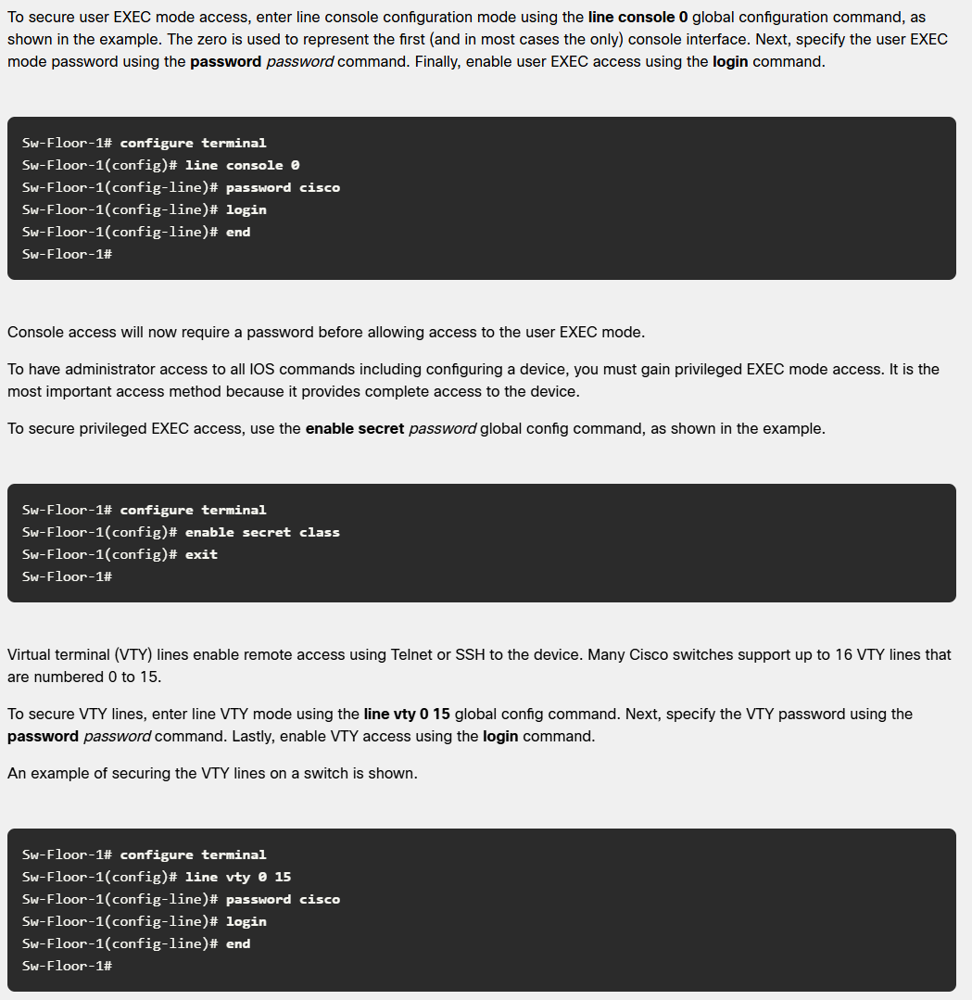
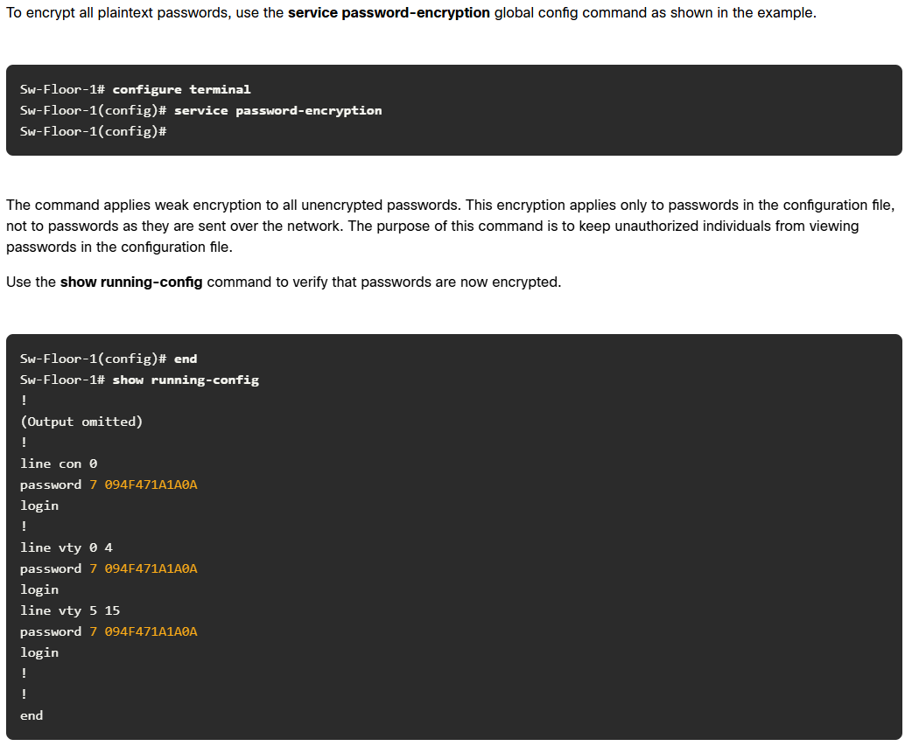
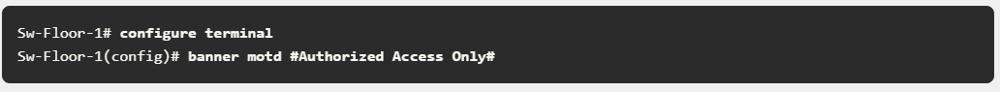
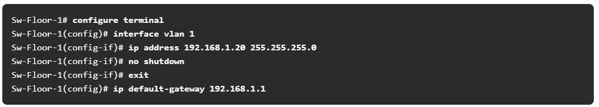

# Configuring User using GitBash
- git config --global user.name "Benjamin Pedrin"
- git config --global user.email "pedrinb@students.westerntc.edu"
- git config --global core.autocrlf true
- git config --global --list

## Creating SSH keys
- ssh-keygen -t ed25519 -C "pedrinb@students.westerntc.edu"

### 1. Start the agent and add the key (Holds key in memory while computer is on)

- eval "$(ssh-agent -s)"
- ssh-add ~/.ssh/id_ed25519

### 2. Print & Copy Public Key
- cat ~/.ssh/id_ed25519.pub

### 3. Testing your connection
- ssh -T git@github.com

# * ! * Basic Switch and End Device Configuration
### 1. User EXEC Mode (View-Only)
- limited capabilities - cannot change config of device
- CLI prompt ends with ">"
- type "enable" to enter Privileged EXEC Mode from here

### 2. Privileged EXEC Mode
- Used to execute config commands
- CLI prompt ends with "#"
- type "configure terminal (<em style="color: violet">config t</em>)" to enter global config mode

<strong>Show Image</strong>

### 3. Global Config Mode
- Identified with prompt that ends with  "(config)#"
  - a. **<u>Line Configuration Mode</u>** - used to config console, SSH, Telnet or AUX access
  - b. **<u>Interface Configuration Mode</u>** - used to config a switch, port or router network interface

 

<strong>Mode Changes</strong>

 

# Syntax

<strong>Syntax Help</strong>

For help in the CLI, enter a question mark (<em style="color: violet">?</em>)prompt.
- this is *context sensitive* meaning that the help you get will be determined by where and when you seek the help

# Hotkeys & Shortcuts

<strong>Hotkeys</strong>

 

# Naming Devices
- When naming a device, enter Privileged EXEC Mode on the device and use <strong><u>hostname</u></strong> or <strong><u>no hostname</u></strong> to change the name or return it to it's original prompt name

 

# Configuring Passwords

<strong>Password Commands</strong>

<strong>Encryption Commands</strong>

<strong>Banner Message</strong>

 

**Be aware that "enable password" and "enable secret" are distinctly different**

 

Configurations commands "shortlist"
- show running-config
- show startup-config
- reload
- erase startup-config
- copy running-config startup-config (copy run start)

# Configuring A Virtual Interface

<strong>Vlan Config</strong>

command: "show ip interface brief"
 